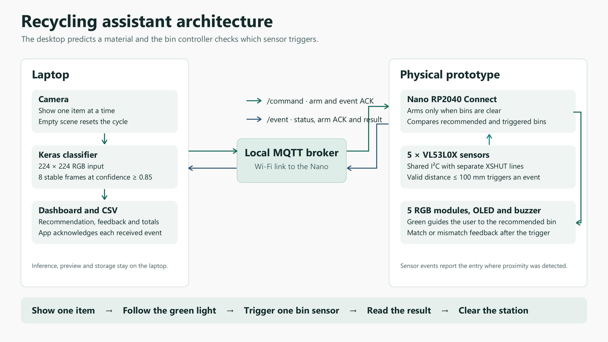
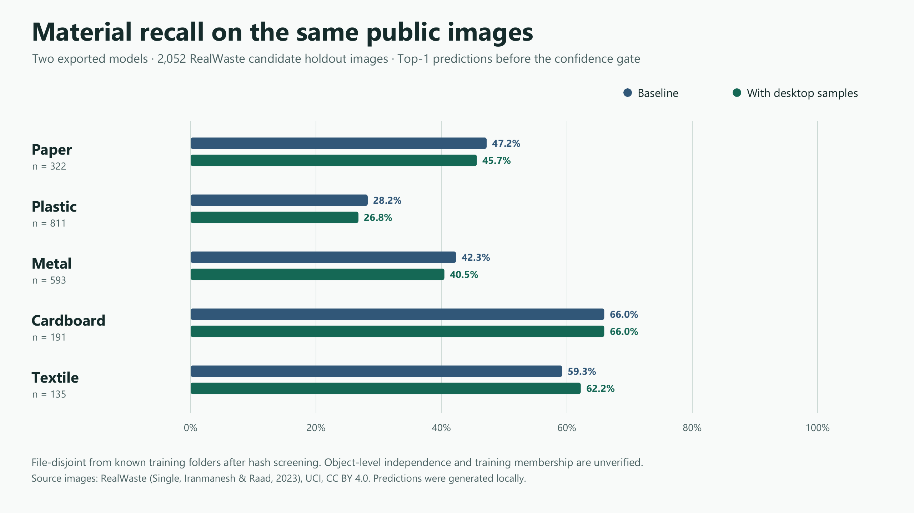

# AI-Enabled Desktop Recycling Assistant

A five-entry, desk-side sorting prototype built with a webcam, Python, MQTT, and an Arduino Nano RP2040 Connect. A local Dashboard recommends an entry for one item at a time and displays whether the user triggered the suggested entry.



## How it works

1. The camera classifies an item as paper, plastic, metal, cardboard, or textile. An empty-scene class helps reset the system between items.
2. After eight consecutive confident frames and a ready signal from the controller, Python sends an entry recommendation over MQTT. The Arduino lights the corresponding entry.
3. The Arduino compares the triggered distance sensor with the recommendation and returns the result. The Dashboard updates its statistics and Python appends the event to a CSV log.

In two recorded prototype trials, the model recommended the metal entry both times. Triggering entry 2 produced a mismatch, and triggering entry 3 produced a match. Both outcomes reached the Dashboard and appeared in the log.

The [controller wiring diagram](docs/Report_Presentation_Assets/02_Controller_Wiring.png) shows the five VL53L0X distance sensors, RGB indicators, OLED, and buzzer.

## Model evaluation

The Dashboard can switch between a RealWaste-based model and a second export trained with supplemental images from our desktop camera. In a familiar can example, the baseline suggested cardboard and the desktop model suggested metal. The table shows how the same models performed on a separate screened set of public images.

| Model | Top-1 accuracy on 2,052 public images | Macro F1 | Median warm CPU inference |
| --- | ---: | ---: | ---: |
| Dataset baseline | 40.8% (838 correct) | 0.404 | 36.45 ms |
| With desktop samples | 39.7% (814 correct) | 0.392 | 36.30 ms |



The public comparison used the same screened images for both models. Physical-item independence could not be verified. The desktop examples used familiar objects and do not establish accuracy on unseen desk items. The timing covers one preprocessed image per warm inference call, excluding capture, frame confirmation, and hardware feedback.

See the [model summary](docs/Report_Presentation_Assets/model_summary.csv), [confidence sweep](docs/Report_Presentation_Assets/threshold_sweep.csv), and [evaluation notes](docs/EVALUATION.md) for the test scope and data.

## Run locally

The following steps use Windows, Python 3.11, a webcam, and Eclipse Mosquitto. Run from the repository root in PowerShell.

```powershell
py -3.11 -m venv .venv
.\.venv\Scripts\python.exe -m pip install -r computer\requirements.txt
Copy-Item computer\config.example.json computer\config.json
.\.venv\Scripts\python.exe computer\dashboard.py --open --start-broker
```

Open [the local Dashboard](http://127.0.0.1:8765/) if the browser does not open. The broker helper looks for Mosquitto in `C:\Program Files (x86)\Mosquitto`. If it is installed in another location, start it there with `mosquitto-demo.conf` and run the Dashboard without `--start-broker`. Camera-only mode is also available:

```powershell
.\.venv\Scripts\python.exe computer\app.py --camera-only
```

To connect the physical prototype:

1. Follow the [wiring diagram](docs/Report_Presentation_Assets/02_Controller_Wiring.png). In Arduino IDE, select **Arduino Nano RP2040 Connect** under **Arduino Mbed OS Nano Boards**. Install WiFiNINA, PubSubClient, ArduinoJson 6.x, Adafruit VL53L0X, Adafruit SSD1306, Adafruit GFX Library, and Adafruit BusIO.
2. Copy `firmware/recycling_controller/secrets.example.h` to `secrets.h` in the same folder and fill in your local Wi-Fi and broker settings. Set the same topic root and port in `computer/config.json`. Use a broker address accessible from the board, such as the laptop's LAN IPv4 address.
3. Use a trusted demo network. If you use the provided Mosquitto configuration, change its listener from loopback to the relevant LAN address and set `broker` in the Python configuration to that address. Compile and upload `recycling_controller.ino`.
4. Select a model, wait until the camera, broker, and board are ready, and select **Start sorting**. Show a clear camera view before presenting an item.

Run the Python tests with `.\.venv\Scripts\python.exe -m unittest discover -s tests`. The Arduino diagnostic sketches in `hardware_tests/` can be used to check individual peripherals.

## Credits

Developed as a two-person university mini-project. OpenAI Codex assisted with implementation, documentation, and evaluation.

- [RealWaste](https://doi.org/10.24432/C5SS4G) by Sam Single, Saeid Iranmanesh, and Raad Raad, UCI Machine Learning Repository, 2023, CC BY 4.0.
- [Google Creative Lab's Teachable Machine Keras example](https://github.com/googlecreativelab/teachablemachine-community/blob/master/snippets/markdown/image/tensorflow/keras.md) informed model loading, centre cropping, and normalisation. The upstream example is licensed under [Apache 2.0](https://github.com/googlecreativelab/teachablemachine-community/blob/master/LICENSE.txt).
